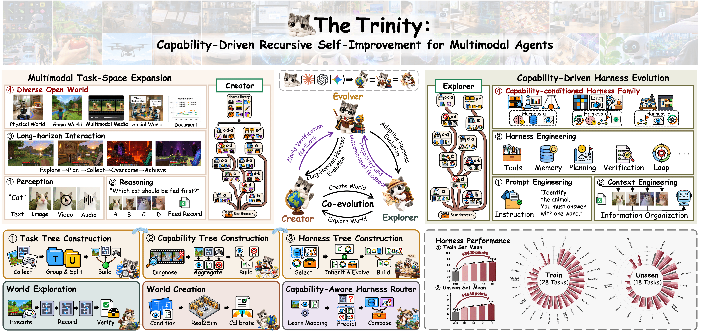

<p align="center">
  
</p>

<h1 align="center">The Trinity</h1>

<p align="center">
  <strong>Capability-Driven Recursive Self-Improvement for Multimodal Agents</strong>
</p>

<p align="center">The Trinity Research Team</p>

<p align="center">
  <a href="paper/The-Trinity.pdf"></a>
  <a href="https://arxiv.org/abs/2610.36077"></a>
  <a href="https://github.com/InfRec-Cardinal/The-Trinity"></a>
  <a href="https://trinity-rsi.github.io/"></a>
  <a href="#citation"></a>
</p>

<p align="center">
  <strong>English</strong> · <a href="README.zh-CN.md">简体中文</a>
</p>

## 🔥 Updates!!

- **Oct 30, 2026:** 🔥 Codes released!
- **Oct 26, 2026:** 🤗 Paper release! The Trinity reached **#1** on [Hugging Face Daily Papers](https://huggingface.co/papers/2610.36077).

## 📑 Open-Source Plan

1. [x] Release code.
2. [ ] Release simulation environments.
3. [ ] Release Harness.
4. [ ] Release Router.
5. [ ] Prepare the [demo website](#try-and-play).

## 📖 Introduction

**The Trinity** is a recursive self-improvement framework that couples world generation with agent Harness evolution. It organizes heterogeneous multimodal tasks by shared capability requirements and connects three roles through verified execution feedback:

- **Creator** builds simplified, verifiable worlds for capability learning.
- **Explorer** interacts with worlds and evolves reusable capability modules through selective inheritance.
- **Evolver** organizes task requirements into a hierarchical capability tree.

**Capability-Driven Real2Sim2Real** connects learning in generated worlds with evaluation on original tasks. A **Capability-Aware Harness Router** selects compatible module configurations for each task. See the [technical report](paper/The-Trinity.pdf) for the method, experiments, and reported results.



<a id="try-and-play"></a>

## 🕹️ Try and Play with The Trinity!

We are preparing an interactive demo website for phased testing to help you explore The Trinity and better understand how it works.

## 🗂️ Code Structure and Release Scope

This release contains the integrated command-line entry point, task discovery and splitting, trajectory analysis and capability induction, Creator–Explorer training, Harness routing, prompts, and accounting utilities.

| Path | Purpose |
| --- | --- |
| [cli.mjs](cli.mjs), [src/](src/) | Integrated commands and cross-stage handoffs |
| [pipeline/](pipeline/) | Stage 1: evidence-backed task discovery, taxonomy, and train/unseen split |
| [stage2/](stage2/) | Stage 2: trajectory analysis, capability induction, and training export |
| [harness/](harness/) | Environment generation, module evolution, evaluation, and routing |
| [config/providers.json](config/providers.json) | Model-provider presets |
| [paper/](paper/), [assets/](assets/) | Technical report and project figures |

Benchmark datasets, runnable benchmark drivers, adapter configurations, experiment snapshots, and routing plans are not bundled. Running the complete workflow requires implementing an environment adapter and obtaining the relevant benchmark resources. The release does not include example or test scripts, and cloning it alone does not reproduce the paper's experiments.

## 🛠️ Requirements

- **Node.js 22 or later.** The JavaScript packages use built-in Node APIs and declare no npm dependencies.
- **Python 3.10 or later.** Stage 2 declares `anthropic>=1.0`; install its package as shown below.
- **Model access** compatible with the configured provider transport. Stage 1 additionally needs working web search. Model names and API versions in the presets must be supported by your account.
- **For full training:** Linux with `/usr/bin/bwrap` (Bubblewrap), usable user namespaces, and `/bin/bash`. The Creator sandbox requires these facilities; WSL must satisfy the same requirements. See [creator-sandbox.mjs](harness/src/creator-sandbox.mjs).
- **For PDF source extraction:** `pdftotext` or Python with `pypdf`. Scanned PDFs require an external OCR workflow.
- Benchmark-specific software, data, and execution access required by your adapter.

## 🚀 Installation

The commands below use Bash and run from the repository root:

```bash
git clone https://github.com/InfRec-Cardinal/The-Trinity.git
cd The-Trinity
python3 -m venv .venv
source .venv/bin/activate
python -m pip install -e ./stage2
export TRINITY_PYTHON="$PWD/.venv/bin/python"
node cli.mjs stage2 --help
```

No `npm install` is needed. `TRINITY_PYTHON` defaults to `python3`; on Windows it can point to `.venv\Scripts\python.exe`. Native Windows does not provide the Linux Creator sandbox required for full training.

Configure a provider through environment variables. Replace the placeholders with values supported by your account:

```bash
export TRINITY_PROVIDER=anthropic
export ANTHROPIC_API_KEY='your-api-key'
export TRINITY_MODEL='account-available-model'
export TRINITY_API_VERSION='supported-api-version'
export PIPELINE_DATA_DIR="$PWD/runs/stage1/data"
export PIPELINE_EXPORT_DIR="$PWD/runs/stage1/exports"
```

The code does not automatically load `.env` files. Keep credentials in your environment. The built-in transport uses the Anthropic Messages protocol, streaming, adaptive thinking, and tools; an arbitrary chat-completions endpoint is not interchangeable. Provider presets are configuration defaults, not a guarantee that a service or model is available.

## 🧭 Usage

Complete the [environment adapter](#environment-adapter) before running exploration or training. Commands that invoke models, search, or benchmarks consume the corresponding resources. Use a new output directory for each `explore`, `train`, and `route` run.

### 1. Discover tasks and export the split

```bash
node cli.mjs stage1 connect-test
node cli.mjs stage1 search
node cli.mjs stage1 status
```

`connect-test` makes real model and search requests. A completed search automatically exports a task tree and handoff. Check that search status is `done` and the split has no gaps or errors; an `incomplete` result may still exit successfully. Select the actual dated export:

```bash
export HANDOFF="$PWD/runs/stage1/exports/stage2-handoff-YYYYMMDD.json"
```

An interrupted search resumes with `stage1 search`. If its budget is exhausted, use `node cli.mjs stage1 budget --turns 80 --searches 32` before resuming. Running `search` after a completed search starts a new search. `search --new` resets the current search state.

### 2. Explore training tasks

```bash
node cli.mjs explore \
  --handoff "$HANDOFF" \
  --adapter local/adapter.json \
  --out runs/explore-train
```

This collects five episodes per training task with frozen initial instances and exports canonical trajectories, `runs.json`, and an execution ledger. The adapter supplies the environment and action budget.

### 3. Analyse trajectories and induce capabilities

```bash
node cli.mjs stage2 all \
  --handoff "$HANDOFF" \
  --runs runs/explore-train/runs.json \
  --out runs/stage2
```

`all` imports training records, builds digests, analyses and reviews failures, induces capabilities, assigns tasks, and writes trees. Its training workflow does not use unseen exploration records. Individual commands are listed by `node cli.mjs stage2 --help`.

### 4. Inspect the training configuration, then train

The optional `prepare` command exports the validated training configuration:

```bash
node cli.mjs prepare \
  --stage2 runs/stage2 --adapter local/adapter.json \
  --out runs/training-config.json
```

The output file must not already exist. `train` rebuilds the configuration from Stage 2 and the adapter; it does not read the file exported by `prepare`.

```bash
node cli.mjs train \
  --stage2 runs/stage2 --adapter local/adapter.json \
  --out runs/train
```

Training performs Creator construction and audits, local module evolution, and evaluation. Successful completion writes `training-complete.json` and `routing-candidates.json`, alongside checkpoints and execution evidence.

### 5. Build a routing plan and evaluate

Create `local/routing-plan.json` for your benchmark environments. Training exports the candidate pool, but does not generate a complete routing plan. The plan requires schema `trinity-routing-plan-v1`, a `protocolId`, `split` (`train` or `unseen`), `candidates`, and ordered `tasks`. Each task supplies `taskId`, `benchmarkId`, `world`, `publicTask`, positive integer `budget`, and positive integer `modelCallBudget`.

Use the frozen candidate records from `runs/train/routing-candidates.json`. Public task context must exclude private capability labels and evaluation outcomes. Before the first evaluation of each benchmark/Harness pair, supply exactly five `preparationWorlds`, or provide a valid previously frozen skill artifact through `skillDirectory`. See the full [routing plan contract](harness/src/router-protocol.mjs) and [evaluation skill preparation](harness/src/evaluation-skills.mjs).

```bash
node cli.mjs route \
  --plan local/routing-plan.json --adapter local/adapter.json \
  --training-run runs/train --out runs/route
```

### 6. Collect accounting

```bash
node cli.mjs metrics \
  runs/stage1/data runs/explore-train runs/stage2 runs/train runs/route \
  > runs/metrics.json
```

The report aggregates recorded model usage, episode costs, benchmark scores, routing results, and accounting warnings. Monetary cost is not calculated; `monetaryCost` is `null`. Check `accountingComplete` and warnings before comparing runs.

### Unseen exploration after training

Collect unseen records only after the referenced training run has completed:

```bash
node cli.mjs explore \
  --handoff "$HANDOFF" --adapter local/adapter.json \
  --cohort unseen --training-run runs/train --out runs/explore-unseen
```

The completion record must match the handoff and unseen cohort. These records support post-training analysis and evaluation; they are not additional training inputs. Unseen routing uses a plan with `split: "unseen"` and the completed training run. See [protocol-state.mjs](harness/src/protocol-state.mjs) for the enforced bindings.

<a id="environment-adapter"></a>

## 🔌 Environment Adapter

Create your own `local/adapter.json` and `local/driver.mjs`. A minimal configuration shape is:

```json
{
  "driverModule": "./driver.mjs",
  "driverOptions": {},
  "actionBudget": 4
}
```

`driverModule` resolves relative to the adapter JSON. The module must export `createDriver(options)`, returning your driver. The action budget above is an example; choose the budget required by your experiment. A configuration file alone does not implement an environment.

| Driver member | Required behavior |
| --- | --- |
| `loadBenchmark(task)` | Load a benchmark and return a serializable world descriptor. |
| `fingerprint(world)` | Return stable evidence identifying the environment build. |
| `instanceManifest(world, trials)` | Return exactly `trials` reproducible instance descriptors. |
| `reset(world, instance)` | Start a session containing `observation` and `actionSchema`; support reset without an instance for audits. |
| `initialState(session)` | Return stable initial-state evidence for matched execution. |
| `step(session, action)` | Return boolean `done` and `success`, `observation`, and finite nonnegative `cost`; optional `score` and `reward` must be finite. Success requires a terminal receipt. |
| `close(session)` | Optional session cleanup. |
| `designContract`, `buildContract` | Define the Creator design and build output contracts for training. |
| `validateDesign(design, node)` | Validate a proposed design before construction. |
| `materialize(design, proposal, context)` | Build a world from the Creator workspace and proposal. |
| `inspect(world, design, buildDigest)` | Provide native inspection evidence for the built environment. |
| `creatorAuditPlan(world, design)` | Provide executable audit plans used to verify Creator worlds. |

The first seven members cover exploration and environment execution; full training also requires the Creator members. Consult [integration.mjs](src/integration.mjs), [explorer.mjs](harness/src/explorer.mjs), [creator-coding.mjs](harness/src/creator-coding.mjs), and [creator-audits.mjs](harness/src/creator-audits.mjs) for exact contracts. Environments must support reproducible resets and host-verifiable outcomes.

The default agent backend uses the configured provider. Advanced integrations can set `agentCommand` and `agentOptions` in the adapter to use the [command-agent protocol](harness/src/agent.mjs).

## ⚙️ Configuration and Outputs

| Setting | Meaning |
| --- | --- |
| `TRINITY_PROVIDER` | Provider preset from [providers.json](config/providers.json). |
| `TRINITY_API_KEY` | Fallback API key; provider-specific key variables take precedence. |
| `TRINITY_MODEL`, `TRINITY_API_VERSION` | Override the model and API version for the active provider. |
| `TRINITY_BASE_URL`, `TRINITY_AUTH` | Override endpoint and authentication (`x-api-key` or `bearer`). |
| `TRINITY_WEB_SEARCH`, `TRINITY_EFFORT` | Search mode and reasoning effort supported by the provider. |
| `TRINITY_PROVIDERS_FILE` | Use an external provider configuration file. |
| `TRINITY_PYTHON`, `TRINITY_NODE` | Python executable used by the integrated Stage 2 command, and Node executable used for Stage 2 protocol verification. |
| `PIPELINE_DATA_DIR`, `PIPELINE_EXPORT_DIR` | Stage 1 state and export locations; defaults are `pipeline/data` and `pipeline/exports`. |
| `PIPELINE_PDFTOTEXT`, `PIPELINE_PDF_PYTHON` | Optional executable overrides for PDF extraction. |

Stage 1 currently excludes audio task inputs. Its default unseen fraction is `18/46`, applied per direction with provenance eligibility and at least one training task retained; discovered task counts are not fixed. To change a completed library's split, run `node cli.mjs stage1 split --unseen-fraction 0.4` followed by `node cli.mjs stage1 export` before downstream work.

Training settings such as iterations, action budget, build attempts, and screening are read from the adapter with defaults in [harness/config/defaults.json](harness/config/defaults.json). Training and validation each require five episodes.

| Output directory | Main contents |
| --- | --- |
| `runs/stage1/data`, `runs/stage1/exports` | Search state, captured evidence, checkpoints, task trees, and dated handoffs |
| `runs/explore-train` | `runs.json`, canonical `records/`, frozen instances, and `events.jsonl` |
| `runs/stage2` | Analyses, reviewed capability catalogue, assignments, and trees |
| `runs/train` | Checkpoints, Creator evidence, summary, routing candidates, and completion record |
| `runs/route` | Frozen plan, evaluation skills, execution ledger, and hashed routing predictions |

Preserve the complete run directories: later stages verify source ledgers and artifact hashes, not just copied summary files.

<a id="citation"></a>

## 📝 Paper and Citation

**The Trinity: Capability-Driven Recursive Self-Improvement for Multimodal Agents**

The Trinity Research Team, 2026.

[Read the technical report](paper/The-Trinity.pdf) · [Visit the project page](https://trinity-rsi.github.io/)

```bibtex
@misc{tang2026trinity,
  title={The Trinity: Capability-Driven Recursive Self-Improvement for Multimodal Agents},
  author={Tang, Weidong and Wang, Ruiheng and Zhang, Jingxuan and Wang, Hexin and Chen, Haoyuan and Zhang, Zhengfeiyang and Ma, Yixing and Jiang, Zichen and Guo, Ziyu and Li, Haodong and Jiao, Zhengbo and Cui, Zhiqing and Yin, Xinxiang and Liang, Shuo and Wan, Zhenglin and Lin, Hongzhan and Zhao, Wangbo and Zhang, Kaipeng and Zhou, Pengfei and Zhang, Odin and You, Yang},
  year={2026},
  eprint={2610.36077},
  archivePrefix={arXiv},
  primaryClass={cs.AI},
  doi={10.48550/arXiv.2610.36077},
  url={https://arxiv.org/abs/2610.36077}
}
```

## 📄 License

The source code is released under the [MIT License](LICENSE). External benchmark resources and dependencies remain subject to their respective licenses.
